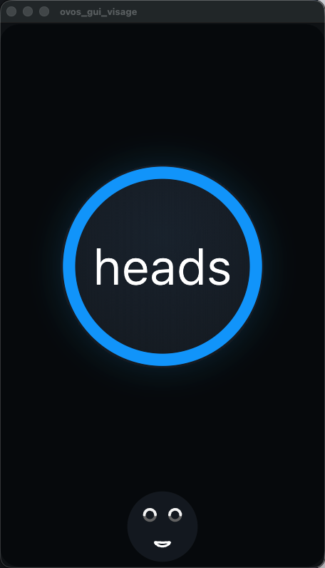
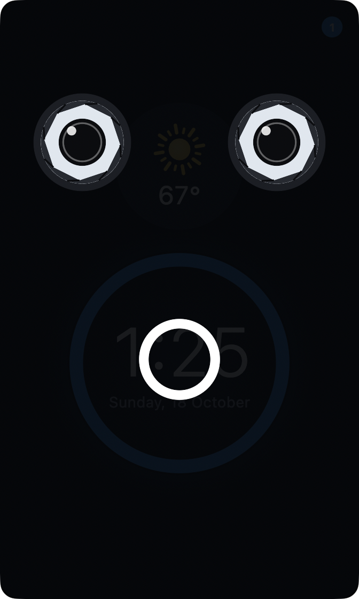
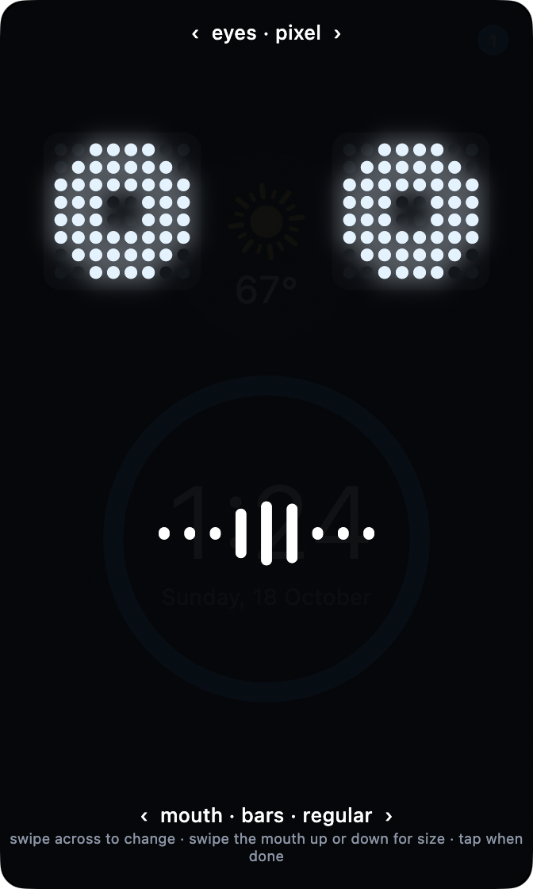
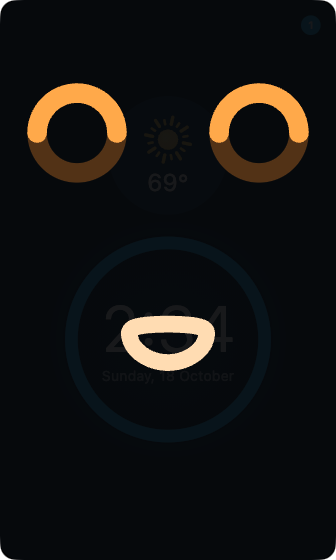
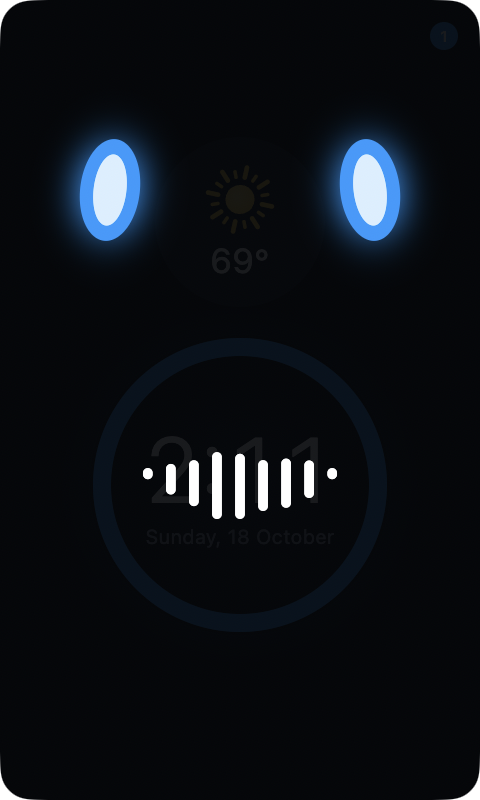
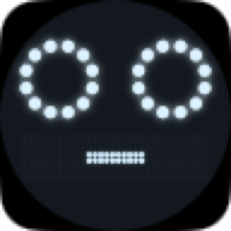

# ovos-gui-visage

[](https://github.com/OscillateLabsLLC/.github/blob/main/SUPPORT_STATUS.md)
[](https://github.com/OscillateLabsLLC/ovos-gui-visage/actions/workflows/unit_tests.yml)

<p align="center">
  
  
  
</p>

A Flutter GUI client for [OpenVoiceOS](https://openvoiceos.org) that expands the 2018
Mycroft Mark II Kickstarter concept: a tall portrait screen, big circular widgets, and a
face that listens, thinks and speaks with a viseme-driven mouth. It is the native port of
[ovos-visage](https://github.com/OscillateLabsLLC/ovos-visage), built for macOS first, then
Linux and the web. It connects to a stock `ovos-gui` service as a GUI client, so no
OVOS code is modified, and renders the homescreen, the system templates, and the weather,
date-time, alerts and OCP media pages. Any other skill page shows as a debug card.

```
ovos-core ──core bus 8181──▶ ovos-gui-service ──GUI ws 18181──▶ ovos-gui-visage (this app)
skills, homescreen                 ▲ ovos.widgets.* translation       reads ~/.cache/ovos_gui directly
```

## Install

Visage runs on the machine where OVOS runs. It needs OVOS's GUI service as well, which is a one-time
setup (next section).

**macOS 12 or later**, with Homebrew:

```bash
brew install --cask oscillatelabsllc/tap/ovos-gui-visage
```

The cask installs `OVOS Visage.app` in `/Applications`. Without Homebrew, download
`ovos-gui-visage-<version>-macos.zip` from the
[releases](https://github.com/OscillateLabsLLC/ovos-gui-visage/releases), unzip it and move the
app to `/Applications`. The app is signed with a Developer ID and notarised, so it opens without
any security prompt. `docs/PACKAGING.md` describes how a release is built.

**Linux, including a Raspberry Pi** (amd64 or arm64): Visage runs in a browser, served by a small
container on the OVOS machine:

```bash
docker run -d --name visage --restart unless-stopped --network host \
  -e OVOS_HOST=127.0.0.1 \
  -v ~/.cache/ovos_gui:/srv/ovos_gui:ro \
  ghcr.io/oscillatelabsllc/ovos-gui-visage:latest
```

Then open `http://<ovos-machine>:8080/` in any browser on your network. For a full-screen face on a
display attached to the machine, use `chromium --kiosk http://127.0.0.1:8080/`. If port 8080 is taken,
add `-e VISAGE_PORT=8090`. OVOS listens only on `127.0.0.1` by default, which is why the container
shares the host's network. `sidecar/compose.yaml` does the same with `docker compose`, and
[Web build and sidecar](#web-build-and-sidecar) has the details. A native Linux app (the corner widget,
the tray) builds from source today (see [On Linux](#on-linux)); packages are tracked under the
[`linux` label](https://github.com/OscillateLabsLLC/ovos-gui-visage/issues?q=label%3Alinux).

## Set up the OVOS side (once)

Visage is a client of `ovos-gui`, OVOS's GUI service, and shows the homescreen skill when nothing else
is on screen. Stock OVOS settings work; nothing in `mycroft.conf` needs to change.

Install both in **their own virtualenv**, never the one OVOS runs from. The homescreen pins an older
`ovos-workshop`, and installing it next to OVOS would downgrade packages OVOS needs:

```bash
python3 -m venv ~/.venvs/ovos-gui
env -u VIRTUAL_ENV -u PIP_CONSTRAINT -u UV_CONSTRAINT \
  ~/.venvs/ovos-gui/bin/pip install --pre ovos-gui ovos-workshop ovos-skill-homescreen
```

The `env -u` part clears settings that OVOS alpha installs export and that would otherwise stop pip
from resolving the homescreen's dependencies.

## Running

With OVOS running, start the GUI service and the homescreen (two terminals, or as services):

```bash
~/.venvs/ovos-gui/bin/ovos-gui-service
~/.venvs/ovos-gui/bin/ovos-skill-launcher ovos-skill-homescreen.openvoiceos
```

Then open **OVOS Visage** from Applications on macOS, or the browser page on Linux. On macOS it
starts as a small face in a corner of the desktop, with a face icon in the menu bar for everything else
([As a desktop widget](#as-a-desktop-widget)).

**Is it working?** Say "what time is it" (or ask anything). The face listens, thinks and answers,
and the clock shows. If the face never reacts, check that the GUI service is listening on port
18181 (`lsof -iTCP:18181 -sTCP:LISTEN` on macOS, `ss -ltn | grep 18181` on Linux).

## How it works

- **Seam.** `lib/protocol/` announces `framework: html` on the core bus, gets the port, opens
  the GUI socket and announces again (ovos-visage SPEC 5.1).
- **State.** `lib/state/gui_state.dart` mirrors namespaces, pages, session data and the
  active-skill stack. The recorded fixtures from ovos-visage replay to the same snapshots as
  its Python reference (`test/fixtures/expected`).
- **Widgets.** `lib/widgets/widget_manager.dart` plays the shell companion's role for the
  alerts skill's `ovos.widgets.*` messages.
- **Resources.** Session values that are image paths are read straight from
  `~/.cache/ovos_gui` or wherever the skill put them; no file server. The web build fetches
  the same paths from the sidecar instead (`lib/resources/`).
- **Web views.** `SYSTEM_UrlFrame` and `SYSTEM_HtmlFrame` open a web view where the platform
  has one (macOS, and an iframe on the web); elsewhere they show the URL or the page's text.
- **Faults.** Anything the display survives by showing a fallback is reported through
  `lib/faults.dart` first, so a missing animation or image is in the log, never silent.
- **Pages.** One widget per page, routed by `namespace/page` (system templates by page name),
  with pure view models under `flutter test`. Circles, rings and plain text on black; no cards.
- **Face.** `lib/face/` composes the face from an eye style, a mouth style and a backdrop, each
  drawing into slots a layout hands it, so any eyes pair with any mouth. Nine eye styles and
  eight mouth styles ship (`docs/FACE_PALETTES.md`), the mouth tweens between seven viseme
  outlines timed by `enclosure.mouth.viseme_list`, and two backdrops: the bare screen, and the
  Mycroft Mark 1 faceplate with its ring wells and 32 × 8 LED window. `visage` (the Kickstarter
  concept face) and `mark1` are presets of the same parts.

`docs/SCOPE.md` records the port's decisions, the platform gating and the phases; `docs/BACKLOG.md`
holds feedback and ideas queued behind them.
ovos-visage's `docs/SPEC.md` remains the protocol and visual reference.

## Changing the face

The face is `"face"` in the config file: a preset name, `eyes+mouth` tokens with an optional
`large` and an optional colourway, or an object. `VISAGE_FACE` takes the string forms.

```json
{"face": "mark1"}
{"face": "aperture+grille+large+ember"}
{"face": {"eyes": "oval", "mouth": "none", "mouthSize": "large", "backdrop": "none", "colours": "mint"}}
```

`colours` is the colourway, and every style paints in it. The named ones are `visage` (the
default), `ember` (amber eyes, orange accent), `mint` (mint with a lavender accent), `rose` (pink
with a teal accent), `ice` (pale blue with a violet accent) and `mark1` (the Mark 1 LED colours on
every part). A preset brings its own colourway: `mark1` brings `mark1`, the others `visage`, so a
colourway after the preset wins (`pod+ember`, not `ember+pod`). For your own colours, give an
object of `#RRGGBB` or `#AARRGGBB` per token; a token you leave out is the visage one, and
`matrixGlow` follows `matrix` when you give only `matrix`:

```json
{"face": {"eyes": "lens", "mouth": "outline", "colours": {
  "eye": "#FFD166", "eyeDim": "#5A4A20", "mouth": "#FFF4D6", "accent": "#EF476F",
  "led": "#B8963E", "matrix": "#FFE9A8", "matrixGlow": "#FFD166"}}}
```

A bad hex string or an unknown colourway is logged and falls back to visage for that part.

<p align="center">
  
</p>

It changes while running, three ways, and every change is written back to the config file:

- **From a browser.** `docs/face-palettes.html` shows the presets as cards, with eyes, mouth,
  size and colour under "Customise this face" and every pairing behind "Show every combination";
  served by the sidecar at `/faces.html`, or opened with `?bus=ws://host:8181` (or
  `#bus=ws://host:8181`), it connects to the OVOS bus and every tap changes the device's face. It
  follows changes made any other way. On macOS, **Face picker…** in the menu bar opens it already
  connected; `visage.face.picker` on the bus does the same.
- **On the screen.** Long-press anywhere to try faces on: the face comes up full and speaks a demo
  loop; swipe across the eyes or across the mouth to cycle styles, swipe the mouth up or down for
  a large or regular mouth, tap when done. There is no colour gesture yet; choose a colourway
  from the picker page, the bus or the config file. A pointer works as well as touch, so this works in
  `window` and `float` modes; the desktop widget sits beneath every window and gets no input.
- **Over the bus.** `visage.face.set` with any of `preset`, `eyes`, `mouth`, `mouthSize`,
  `backdrop` and `colours` (a name or a token object) changes those parts; `visage.face.get` asks; `visage.face.state` answers both and
  announces every change, with the names available for each part. `visage.face.picker` opens the
  picker page on the display's own machine. A voice skill that maps "give
  yourself oval eyes" to that message is all a voice interface needs; nothing in OVOS changes.

## As a desktop widget

By default the app is a desktop widget: a frameless window in the top-right corner, 400 px
tall, beneath every other window and above the wallpaper, on every Space. `float` keeps the
same window above everything instead, and `window` is an ordinary window. Configure it in
`~/.config/ovos-gui-visage/config.json`:

```json
{"window": {"mode": "desktop", "corner": "top-right", "height": 400, "margin": 16, "peek": false, "peekSize": 96}}
```

`VISAGE_MODE`, `VISAGE_CORNER`, `VISAGE_HEIGHT`, `VISAGE_MARGIN`, `VISAGE_PEEK` and
`VISAGE_PEEK_SIZE` override the file, so a launcher script can pick the mode. Corners are
`top-left`, `top-right`, `bottom-left`, `bottom-right`; the height is in logical pixels and the
width follows the 480 × 800 frame. This is a real window with the live sockets and animations,
which a WidgetKit widget cannot have: widget extensions get no sockets and only a handful of
timeline refreshes an hour.

### On Linux

The widget modes were checked on Kubuntu 24.04 (X11, KWin, Plasma): `window`, `float`, `desktop`,
peek and kiosk all place correctly, the rounded frame floats on the desktop, and `desktop` stays
beneath other windows through the window manager's keep-below flag. Differences from macOS: the menu lives in a
system tray item (an app indicator, which needs `libayatana-appindicator3-1` installed; Plasma shows it,
GNOME needs the AppIndicator extension), and on X11 or Xwayland a widget can be dragged to another corner, where it snaps and
the corner is saved; the widget sits on one virtual desktop (window_manager has no all-workspaces call on Linux, and
the log reports it once); kiosk covers the panel through the window manager's fullscreen state and keeps
the display awake with an idle inhibit on the session bus.

The app asks GTK for X11 first and native Wayland second, so in a Wayland session it runs through
Xwayland when Xwayland is installed. `GDK_BACKEND=wayland` still forces native Wayland.

| Session | What you get |
|---|---|
| X11 (checked on Plasma 5.27) | Every mode as described above. |
| Wayland with Xwayland (checked on nested KWin 5.27) | The same as X11: the app is an X11 client, so corners, keep-above, keep-below, peek, drag-to-corner and kiosk all work. |
| Wayland without Xwayland, or `GDK_BACKEND=wayland` | `window` and `kiosk` work. A `float` or `desktop` widget opens at its correct size but where the compositor puts it, and not above or below other windows; drag moves it but does not snap or save a corner. The log says this once at start. Install Xwayland to get the widget modes. |
| GNOME (Wayland or X11) | Not tested. Under Xwayland it should behave as X11. The tray needs the AppIndicator extension; without it the log says so once. |

If no panel on the session bus can show a tray item (no `org.kde.StatusNotifierWatcher`, as on stock
GNOME), the log names the GNOME **AppIndicator and KStatusNotifierItem Support** extension once. The
item appears without a restart when a tray starts later. Until then, use the bus messages
(`visage.window.*`, `visage.face.*`) to change the mode or the face.

#### Launcher and icon

Until there is a package, add the launcher by hand after a release build. The launcher and the
icons go in your home folder only:

```bash
flutter build linux --release
just linux-install      # or: tool/linux_desktop.sh install
```

This writes `~/.local/share/applications/net.oscillatelabs.ovosGuiVisage.desktop`, with `Exec`
set to the bundle under `build/linux/<arch>/release/bundle`, and copies the icons from
`linux/icons/hicolor` to `~/.local/share/icons/hicolor`. Then it runs `update-desktop-database`
and `gtk-update-icon-cache`. **OVOS Visage** then shows in the application menu, and the panel
shows the face icon for its window. The file name, the icon name and the GTK application id are
all `net.oscillatelabs.ovosGuiVisage`, which is how the desktop matches the window to the
launcher. `just linux-uninstall` removes the launcher and the icons. If you move the checkout,
run `just linux-install` again.

#### Start in kiosk mode when you log in

This is off by default. To turn it on:

```bash
just linux-autostart on     # or: tool/linux_desktop.sh autostart-on
```

This writes `~/.config/autostart/net.oscillatelabs.ovosGuiVisage-kiosk.desktop`, which starts
the app with `VISAGE_MODE=kiosk`. To turn it off, run `just linux-autostart off`, or delete that
file. Plasma also lists the entry in System Settings, Autostart, where you can turn it off.

If the app starts before OVOS is ready, it shows the clock with a **GUI offline** label. It tries
to connect again every 3 seconds, and shows the OVOS screens as soon as OVOS answers. You do not
need to add a delay.

### Peek mode

With `"peek": true` (or `VISAGE_PEEK=1`), the widget stays out of the way. At rest it is a round
badge, `peekSize` pixels across, in its corner: the resting face, still blinking. When OVOS
listens, thinks or speaks, the window grows to its full size in the same corner and shows the
page and the face. Three seconds after the face hides, it shrinks back to the badge. In `float`
mode, a click or tap on the badge opens the window for ten seconds, and try-on mode keeps it open
until you tap out. Peek mode applies to `float`
and `desktop` only; an ordinary `window` ignores it.

<p align="center">
  
  &nbsp;
  
</p>

The Mark 1 face draws a bolder version of itself in the badge, so it stays easy to see at 96 pixels: the
ring lights are larger and bright, and the resting mouth is a short bar. The full-size face keeps the
Mark 1's own dim ring colour.

<p align="center">
  
  &nbsp;
  
</p>

The window also changes over the bus. `visage.window.set` with `peek` (true or false) turns peek
mode on or off and writes it to the config file; with `expanded` (true or false) it opens or
closes the window once and does not change the config. A one-off open stays open until the next
listen, think or speak cycle ends. `visage.window.get` asks for the state, and
`visage.window.state` answers both and announces every change, with `mode`, `corner`, `peek`,
`peekSize`, `expanded` and `visible`. `visible` (true or false) hides or shows the window for this
run only. `mode` (`float`, `desktop` or `kiosk`) moves a widget above or beneath other windows,
or fills the screen, and writes it to the config file. Every mode can go into `kiosk` and come
back out. Apart from that, an ordinary `window` cannot become a widget while it runs, and a widget
cannot become an ordinary window.

### Kiosk mode

Kiosk mode makes the screen show only the assistant. Start it with `"window": {"mode": "kiosk"}`
in the config file, with `VISAGE_MODE=kiosk`, with **Full screen** in the menu bar, or with
`visage.window.set {"mode": "kiosk"}` on the bus. The window fills the primary display. The
480 × 800 frame is scaled to fit, with black bars at the sides. The window stays above other
apps and notifications on every Space. While the app is in front, the Dock is hidden and the menu
bar hides until you move the pointer to the top edge. The menu bar item is still there. The
pointer hides after 5 seconds without movement.

The display does not go to sleep while kiosk mode is on. The app holds a macOS power assertion,
"ovos-gui-visage kiosk keeps the display awake" (`pmset -g assertions` shows it), and releases it
when kiosk mode ends or the app quits. On Linux it asks the desktop's screen saver service
(`org.freedesktop.ScreenSaver`, or the desktop portal when that is missing) not to blank the display;
on Plasma it shows, after five seconds, in
`qdbus --literal org.kde.Solid.PowerManagement.PolicyAgent /org/kde/Solid/PowerManagement/PolicyAgent ListInhibitions`.

To leave, press Escape, click **Full screen** again, or send `visage.window.set {"mode": "float"}`.
Escape and **Full screen** go back to the mode you were in before kiosk. If the app started in
kiosk, they go to the mode the config file names, or to `float` if the file says `kiosk`. Kiosk
is saved like the other modes, so a kiosk screen is still a kiosk after a restart. Peek mode does
not apply in kiosk.

<p align="center">
  
</p>

### Menu bar

On macOS, a widget is a menu bar app with no Dock icon. A face icon in the menu bar opens a menu
that does what the bus does, so the face stays under control without a bus client:

- **Show face** / **Hide face**: removes the window from the screen and puts it back. A hidden widget
  stays running in the menu bar.
- **Peek mode**: turns peek on or off and writes it to the config file.
- **Float above windows** / **Sit on the desktop**: changes the mode at once and writes it to the
  config file.
- **Full screen**: goes into kiosk mode, or comes out of it when checked.
- **Face** and **Colours**: the presets and the colourways, with the current ones checked. A
  colourway keeps the eyes and mouth you have.
- **Face picker…**: opens the picker page in your default browser, connected to the bus this app
  uses. Each time, the app writes the page to `~/.config/ovos-gui-visage/faces.html` and a small
  `open-faces.html` beside it that passes the bus on, since macOS drops a file URL's `#bus=`.
- **Quit OVOS Visage**.

Peek and the two modes are greyed out in an ordinary `window`, which keeps its Dock icon. In
kiosk mode only peek is greyed out. The menu follows every change, from the bus, try-on mode or the menu itself.

<p align="center">
  
</p>

## Web build and sidecar

For a display on another machine, the web build runs in a browser served by a sidecar on the
OVOS host. The sidecar serves the app, the face picker at `/faces.html`, the GUI cache under `/res/`, the
host's files under `/res-abs/`, and proxies the two websockets, so port 8080 (`VISAGE_PORT`) is the only
one to expose. Anyone who reaches it can drive the OVOS bus through the proxy: keep it on a trusted
network, or put authentication and TLS in front of it.

The container uses the host's network, because OVOS listens only on `127.0.0.1` by default and a
container on Docker's own network cannot reach that. On Docker Desktop, turn on host networking in its
settings first.

```bash
docker compose -f sidecar/compose.yaml up -d          # on the OVOS host: pulls ghcr.io/oscillatelabsllc/ovos-gui-visage
docker compose -f sidecar/compose.yaml up -d --build  # or build the image from this checkout
```

Each release publishes the image for amd64 and arm64, tagged with the version (for example `1.1.0`, `1.1`, `1`) and
`latest`. Set `VISAGE_TAG` to pin a version with compose.

To try the web build against a local OVOS without the sidecar:

```bash
flutter build web --release
python3 tool/serve_web.py          # http://127.0.0.1:8099/?bus=ws://127.0.0.1:8181 and /faces.html?bus=…
```

## Development

Building needs Flutter 3.47 or newer (on Linux also `ninja-build`, `libgtk-3-dev` and
`libayatana-appindicator3-dev`), and Docker for the sidecar image. With the GUI service and the
homescreen running as above:

```bash
VISAGE_MODE=window flutter run -d macos     # or -d linux; without the variable it starts as a desktop widget
```

The window shows the 480 × 800 screen scaled to fit. To try it without a microphone, inject
an utterance on the core bus with ovos-visage's `docs/spike_say.py "what time is it"`, or run
its `tests/manual/demo.py` tour; both only talk to the bus, so they drive this app unchanged.

```bash
just test      # flutter test
just lint      # dart format check + flutter analyze
just run       # flutter run -d macos
```

The face picker page has its own test. It opens `docs/face-palettes.html` in headless Chrome
against a fake message bus. It checks the keyboard, taps, "Saved", "Not saved", Undo, the
`#customise` and `#all` links, and reduced motion. It needs Google Chrome (or `CHROME` set to
the path of a Chrome or Chromium) and `pip install websocket-client`:

```bash
python3 -I tool/test_picker.py     # exit code 0 when every check passes
```

See `CONTRIBUTING.md`.

## License

Apache 2.0
